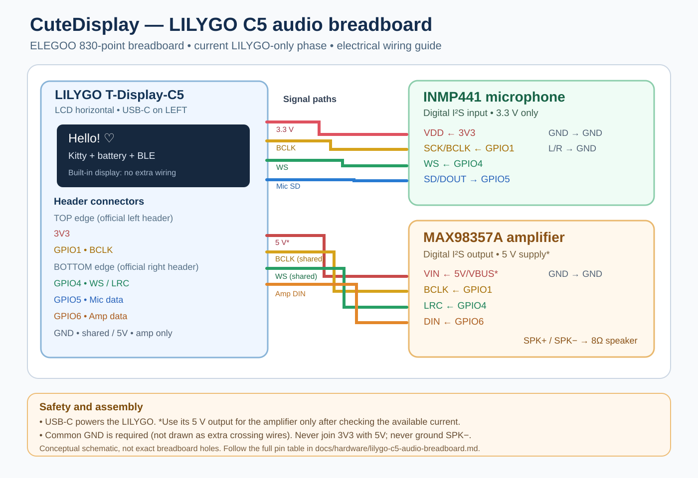

# CuteDisplay 🎀

## About CuteDisplay

**CuteDisplay** is a customizable, battery-powered miniature companion display built around the **LILYGO T-Display C5 (ESP32-C5)** and controlled from a companion **iPhone app**. The idea is to turn a small LCD into a playful, expressive accessory: it can show a cute animated character, a personal message, or a rotating list of drinks, while the phone acts as the convenient place to configure and manage it.

Rather than being a passive screen, CuteDisplay is designed as a connected little character that you can personalize and, eventually, **talk to**. The project brings together custom ESP32 firmware, a native SwiftUI iOS interface, Bluetooth communication, optional local Wi-Fi connectivity, and planned AI-powered voice interactions.

### What the ESP32 firmware does

The firmware runs directly on the display hardware, so its screen and core animations do not depend on the iPhone staying open. It handles:

- Rendering six animated mascot styles, moods, accessories, reactions, and optional surprise animations.
- Displaying custom text with Japanese/Unicode support, speech bubbles, and visual themes, or showing a paginated drinks list.
- Tracking the onboard battery through the AXP2602: charge level, voltage, current, temperature, health, and estimated time remaining or to full.
- Managing brightness, on-device button controls, Bluetooth communication, and optional Wi-Fi connectivity.
- Preparing for two-way audio through an external I²S microphone and speaker amplifier. The current test records a short clip and plays it back locally; **it does not yet talk to an AI model**.

### What the iPhone app does

The **CuteDisplay iOS app** is the control panel for the physical device. From the phone, you can pair and reconnect to the display, customize its mascot and animations, select colors and layout options, write messages, and edit the drinks shown on screen. It also provides battery and power information, brightness controls, saved display profiles, Wi-Fi settings, and optional low-battery alerts.

Communication is primarily over **Bluetooth Low Energy**. The project also supports an optional authenticated local-network fallback when the device and phone are on a reachable Wi-Fi network; this fallback is not end-to-end encrypted and does not guarantee operation while iOS suspends the app.

### General concept and future direction

The long-term goal is a **small physical AI companion with personality**: hold the device's button, speak into its microphone, send the audio to a selectable **local AI backend or OpenAI API**, and hear the response through the speaker, potentially accompanied by expressions or messages on the LCD.

Development is incremental. Today, the animated display, phone controls, battery telemetry, and connectivity form the core product. The microphone-to-speaker loopback is an early hardware test for the planned voice interface, **not a completed AI assistant**. The user can continue enjoying CuteDisplay as a personalized display while the audio and AI components are developed.

---

## Current breadboard wiring diagram



**Diagram note:** This is an electrical connection guide, not a verified hole-by-hole breadboard placement. **GPIO1 and GPIO4 are shared I²S clocks; GPIO5 (microphone input) and GPIO6 (amplifier output) must remain separate.** Use the [detailed ELEGOO 830 breadboard guide](docs/hardware/lilygo-c5-audio-breadboard.md) for the official top/bottom LILYGO header layout, microphone/amplifier power separation, speaker connections, and safety checks.

## Repository synchronization status — 2026-10-26

**Current hardware target:** LILYGO T-Display-C5 **only**. The current 830-point breadboard wiring guide is [docs/hardware/lilygo-c5-audio-breadboard.md](docs/hardware/lilygo-c5-audio-breadboard.md). It documents the exact GPIO mapping and header contacts from the official LILYGO pinout. The microphone and amplifier share I²S **clocks**, but use **separate data pins**. Earlier generated pictures that show both data connections on GPIO5 must not be used as wiring references.

**Current firmware:** `firmware/CuteDisplay/lcd.ino` (4.2 hardware audio loopback). **Current iOS app sources:** `ios/CuteDisplay/ContentView.swift` and `ios/CuteDisplay/BluetoothManager.swift`. This synchronization is a source/documentation update, **not** an independently compiled/flashed hardware release. The 830-point bench assembly, 5 V amplifier power budget, and loopback operation remain to be tested on the actual devices.

**Planned next steps:** (1) local mic-to-speaker test with INMP441 + MAX98357A; (2) server-based STT, Ollama conversation and TTS streaming; (3) synchronized speaking/listening mascot animations and AI text; (4) optional future migration to Freenove ESP32-S3 CAM + Waveshare 1.9-inch screen. The S3 is **not part of the current wiring**, and camera/video functionality is not implemented.

## Earlier source synchronization status — 2026-10-23

The latest ESP32-C5 source (`firmware/CuteDisplay/lcd.ino`) and the iPhone Wi-Fi fallback transport (`ios/CuteDisplay/BluetoothManager.swift`) are **committed together in the default GitHub branch**. Their companion SwiftUI source and iOS local-network permission instructions are present.

**Production validation is pending:** GitHub synchronization does not flash the ESP32 or install the iPhone app. This repository lacks a complete Xcode project and the external board-specific headers/libraries, so firmware and iOS compilation cannot be verified here. Keep a backup of the last known-working build until the new versions pass device tests.

Wi-Fi fallback requires: the device connected to an existing trusted Wi-Fi network; the iPhone able to reach its local IP on TCP port 8848; an initial BLE connection to retrieve the LAN authentication key/IP; and the `NSLocalNetworkUsageDescription` key in the **actual Xcode app target's Info settings** (the XML file in this repository is an instruction fragment). Fallback is authenticated but **not encrypted**, and foreground/best-effort: iOS can suspend networking in the background or after force-quitting the app. No automatic ESP32 reboot or Wi-Fi activation is introduced.

## Phase 1 button and battery display (2026-10-23)

- GPIO28 **short press: no action**. Hold for 1.4 seconds to run the two-second microphone-to-speaker loopback test.
- GPIO0 retains its existing short-press status display and long-press Wi-Fi toggle.
- Both Time to Full and Time to Empty render as **N hours M min** in the iPhone app. On the ESP32 LCD, the battery-status overlay uses the same format.
- The BLE wire protocol continues to report integer minutes; no BLE characteristic or battery-learning changes were made.
- News/RSS functionality remains removed. The local-AI/OpenAI gateway is planned for later phases and is not included in Phase 1.
- Source changes are committed to GitHub, but are **not yet compiled or verified on the hardware**. The full Xcode project and external board dependencies are not in this repository. Keep the working prototype until tomorrow's audio test succeeds.

## iOS app name and source installation (2026-10-23)

Use the **complete files** in `ios/CuteDisplay/ContentView.swift` and `ios/CuteDisplay/BluetoothManager.swift` in the existing Xcode application target. The Home Screen app label is controlled by the app target's Info.plist/build settings, **not the SwiftUI source**.

To display **CuteDisplay** (instead of DrinkDisplay), open Xcode → TARGETS → app target → **Info** → Custom iOS Target Properties → **Bundle display name** (`CFBundleDisplayName`) = `CuteDisplay`. For projects using generated Info.plist, use **Build Settings** → `INFOPLIST_KEY_CFBundleDisplayName` = `CuteDisplay`. Ensure there is no existing localized `InfoPlist.strings` display-name override. Optionally rename `PRODUCT_NAME` or the target, but it is not required for the Home Screen label. The `AccessorySetup-InfoPlist.xml` in this repo is only a fragment listing keys to add to the real Xcode target.

Preserve the app's bundle identifier and signing configuration to retain its saved data. Build and install on a physical iPhone, then verify the Home Screen label. This repository doesn't include the actual `.xcodeproj`, so changing the target configuration cannot be performed through these source-only files.

## AI voice hardware — Phase 1 (unverified)

The ESP32-C5 firmware now removes all RSS/news fetching and uses GPIO28's long press (1.4 seconds) for a **two-second microphone recording followed by immediate speaker playback**. A short GPIO28 press does nothing. GPIO0 Wi-Fi controls are unchanged. This is a hardware-only loopback test: **no model or OpenAI API is accessed in Phase 1**. The eventual backend will support selecting local AI or OpenAI using the same audio transport.

Current audio GPIO mapping: **GPIO1** BCLK (shared), **GPIO4** WS/LRCLK (shared), **GPIO5** INMP441 SD (input only), **GPIO6** MAX98357A DIN (output only), with common GND. Power the **INMP441 from 3.3 V**; the MAX98357A can use the USB-fed **5 V/VBUS rail only if the LILYGO power budget has been verified**, or a suitably regulated amplifier supply with common ground. **Never join the 3.3 V and 5 V rails, and never ground the amplifier SPK− output.** See the [complete breadboard pin map and power precautions](docs/hardware/lilygo-c5-audio-breadboard.md).

The complete test bundle is also available as `CuteDisplay_AI_Phase1_Audio_NoNews.zip` in the conversation attachments. Audio/I²S compilation and device behavior have **not** been tested here; flash to the spare board first and keep the working prototype unchanged.

## Currently committed firmware: 4.2 (audio-loopback prototype)

The following earlier UI features were established in the 4.0 line; the committed firmware header identifies the current prototype as **4.2**, including GPIO28 audio hardware loopback. These are source-level descriptions, not claims of completed physical validation.

## UI feature baseline (4.0)

- Six procedural, animated mascots and selectable moods (no sprite-sheet art)
- Optional randomized surprise animations (sneeze, stretch, startled, look around, butterfly)
- Adjustable mascot size and visibility; smaller mascots leave more room for text
- Japanese/Unicode text delivered as glyphs over BLE
- Message Mode with optional speech bubble and typewriter effect
- 25 color choices; black screen background with light-tinted speech bubble
- Drinks Mode with contrasting rows, pagination and automatic updates from iPhone
- Live AXP2602 battery percentage, voltage, charging/discharging current, health, temperature, time estimates, and calculated battery-side watts
- Remembered device pairing and automatic BLE reconnection when iOS permits the app to run
- Brightness and deep-sleep button

## Project layout

```text
firmware/CuteDisplay/lcd.ino       Current ESP32-C5 v4.2 sketch with local audio loopback and Wi-Fi fallback
ios/CuteDisplay/ContentView.swift  SwiftUI screen
ios/CuteDisplay/BluetoothManager.swift  BLE communications
docs/hardware/lilygo-c5-audio-breadboard.md Current wiring, pinout and testing checklist
archive/                           Earlier downloadable versions
```

## Setup

### ESP32-C5 firmware
1. Install Arduino IDE and Espressif ESP32 board support (project last used ESP32 core 3.3.12).
2. Use your working **LILYGO board_config.h** and installed **axp2602.h** library. These external board/library files are **not included** in this repository.
3. Open `firmware/CuteDisplay/lcd.ino`. If Arduino IDE asks to create a matching sketch folder, allow it; copy your existing `board_config.h` alongside the sketch as in your working setup.
4. Select the board/port corresponding to the LILYGO T-Display C5, click **Verify**, then **Upload**.
5. **Do not** copy `MascotSprites.h` from 3.5B. That version's sprite artwork was rolled back.

### iPhone app
1. Open your existing CuteDisplay Xcode project. The full `.xcodeproj` was not available in the conversation, so this repository contains the **complete two Swift source files**, not a standalone buildable Xcode project.
2. Replace the corresponding `ContentView.swift` and `BluetoothManager.swift` files with the files in `ios/CuteDisplay/`.
3. Preserve your app's bundle identifier to retain saved app settings.
4. Select your physical iPhone; Build (⌘B), then Run (⌘R). BLE is not available in iPhone Simulator.

## BLE protocol

Uses `FFF0` control service and `FFF1` read/write characteristic; battery service `180F` with characteristic `2A19`. Additional power telemetry is exposed by `FFF3`/`FFF4` (read/notify) as `SOC,volts,amps,tempC,healthPercent,minutesToEmpty,minutesToFull`. Positive amps = charging, negative amps = discharging. Example commands include `D:RESET` / `D:ADD:NAME,COUNT` / `D:SHOW`, `C:<id>`, `T:<id>`, `B:<percent>`, and `S:0` / `S:1` for surprise animations.

## Earlier versions

Historical download packages are in `archive/`. **3.5B is retained only as history**: its sprite-based mascots were intentionally rolled back in favor of the procedural 3.4-style renderer. The latest source combination is the synchronized default-branch firmware and iOS files; on-device validation remains pending.

## Important notes

- **Hardware wiring source of truth:** [C5 audio breadboard guide](docs/hardware/lilygo-c5-audio-breadboard.md). It corrects older illustration mistakes involving shared audio data and supply rails.
- The onboard LILYGO LCD is already connected internally; it requires **no breadboard SPI wires**. The ELEGOO 830 board is used for the microphone/amplifier prototypes.

- Code in this repository is not independently hardware- or Xcode-verified; test on your device and keep backups of your working build.
- Don't commit private credentials, Apple signing certificates, or provisioning profiles.
- The app's deep sleep disables BLE until the board is physically restarted.
## Pairing and power notes

The iPhone app remembers the selected BLE peripheral UUID, automatically attempts reconnection when launched and after disconnection, and offers Pair New Device, Forget Device and an auto-reconnect switch. This is app-level remembered-device pairing, **not an encrypted Bluetooth bond**. Auto-reconnection in the background is subject to iOS execution policies; the app cannot reconnect while the board is in deep sleep. Current and power describe the **battery path**, not the complete USB input consumption. Power is calculated from battery voltage × absolute battery current. Some fuel-gauge estimates may be unavailable or inaccurate depending on calibration and battery conditions.

The changes were not independently compiled or tested on real hardware. Test with the board's original `axp2602.h` and `board_config.h` preserved.

## Native iOS accessory setup (v4.0)

- **Minimum deployment target: iOS 18.0**; add the native `AccessorySetupKit` framework to your app in Xcode.
- **Required manual Xcode configuration:** add the keys from [AccessorySetup-InfoPlist.xml](ios/CuteDisplay/AccessorySetup-InfoPlist.xml) to the app target's existing Info.plist. This repository does not contain the original Xcode project, so these keys cannot be set automatically. The file is an XML fragment, not a complete Info.plist.
- On your iPhone, open the app and tap **Pair New Device**. Select **CuteDisplay** in Apple's accessory picker. After pairing, the accessory is registered with the system and the app reconnects through its authorized Bluetooth identifier.
- Tap **Forget Device** to request removal through Apple's system accessory APIs. The user can also review system-managed accessories in iOS Settings > Privacy & Security > Accessories. Appearance in Bluetooth Settings > My Devices is controlled by iOS and isn't guaranteed for custom BLE hardware.
- The ESP32-C5 now requests secure-connections bonding and encrypted BLE command writes. The board has no convenient passkey-input mechanism; it uses Just Works bonding, which is encrypted but not MITM authenticated.
- If your Xcode app deployment target is below iOS 18, increase it; otherwise the AccessorySetupKit imports will not compile for the older target.
- Background reconnection is iOS-controlled. Additional background mode / state restoration changes would be needed for resilient suspended-app scenarios.
- Verify on your board and real iPhone; these source changes have not been independently compiled, flashed, or physically tested.
