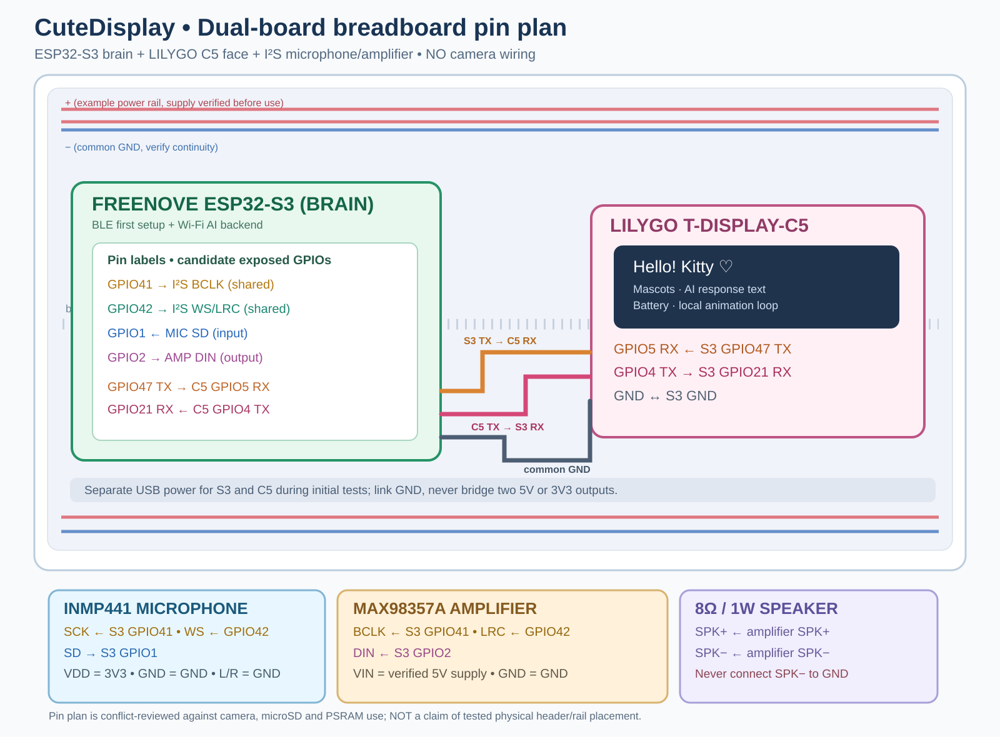
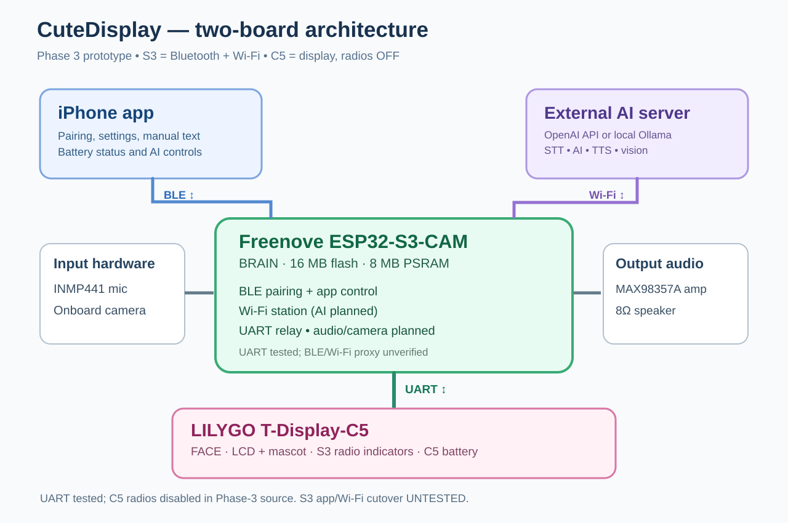

## Known-working hardware baseline — 2026-10-27

**Stable Git branch:** [stable/2026-10-27-audio-tested](https://github.com/ryushi01/CuteDisplay/tree/stable/2026-10-27-audio-tested) at firmware commit [baf2b0b](https://github.com/ryushi01/CuteDisplay/commit/baf2b0b98dfa12b2d732c4618c060ea55e92d804). **Successful combined S3 + C5 build:** [run 40449317276](https://github.com/ryushi01/CuteDisplay/actions/runs/40449317276), artifact **CuteDisplay-CombinedFirmware**. This reference branch pins the firmware and iPhone app sources *before subsequent documentation edits*; do not overwrite it with experimental work.

**Hardware tested:** Freenove ESP32-S3 Brain boots after correctly flashing `CuteDisplayBrain/CuteDisplayBrain.ino` from the combined artifact. A single brief startup beep is audible. C5 Kitty communicates over the established UART. The INMP441 microphone and MAX98357A amplifier operate for a two-second `audio test`; the updated iPhone app's **Test microphone & speaker** button works and displays **Please talk** then **Playing**. iPhone microphone gain and speaker volume controls are implemented. The recorded voice is still **very quiet** through the speaker, accepted as a known limitation for now. The iPhone UI stages use approximate timers, not device-driven acknowledgments.

**Verified microphone diagnostics (300% microphone gain, 100% speaker volume):** Test 1: left peak `1675188224`, mean_abs `302337914`, nonzero `31937`; test 2: left peak `2146351616`, mean_abs `333385275`, nonzero `31991`; `saturated=0`, `all_ones=0` for both. Right slot peak=1, consistent with L/R grounded. Playback auto-gain=1.00x for both, and both tests complete. These are **already high digital sample levels**: do **not** blindly increase software gain. Investigate effective playback encoding/level, MAX98357A GAIN configuration, speaker rating/impedance, speaker connections and acoustics, keeping output and hearing safety in mind. Hardware output loudness and clipping characteristics still require measurement.

**Correct flashing and recovery:** The artifact includes separate `CuteDisplayBrain/CuteDisplayBrain.ino` (**S3**) and `lcd/lcd.ino` (**C5**). **Never flash lcd.ino to the S3**: the C5 LCD driver uses GPIO23 as reset and causes an invalid-GPIO abort on the S3. Arduino IDE S3 settings: ESP32S3 Dev Module, ESP32 core 3.3.12, 16MB flash, OPI PSRAM, Custom partition scheme; disable Erase All Flash Before Sketch Upload to retain credentials. If USB upload hangs at Connecting, disconnect peripherals, hold S3 BOOT, tap EN/RESET, release BOOT and retry at 115200 baud. Keep C5 on its working OTA-capable firmware; the S3 bundle updates C5 over UART as needed. The compiled S3 application `.bin` is **not** a full factory image: flash through the generated Arduino sketch unless using an explicitly supported app-offset updater.

**Known limitations:** speaker loopback remains quiet; do not declare it resolved. A green GitHub Actions build confirms compilation, not all hardware behavior. Keep this stable branch intact and put future features on main.

---

## VERIFIED HARDWARE MILESTONE — 2026-10-27

The user **successfully flashed the C5 OTA receiver by USB, then updated C5 v1 → v2 solely via the S3 USB upload and existing 921600-baud UART**. S3 Serial Monitor confirmed **C5 v1**, inactive OTA slot **6,553,600 bytes**, subsequent **SUCCESS: new display firmware confirmed after reboot**. Kitty restarted, responds normally, and iPhone BLE/app controls work. The transient CHECK UART warning cleared. No extra update wires are required. Keep C5 USB as recovery if firmware cannot boot.

**Permanent workflow:** For each release, increment `C5_FIRMWARE_VERSION` only when C5 source changes (currently v2); make S3 changes normally. GitHub Actions [Build combined S3 + C5 firmware](https://github.com/ryushi01/CuteDisplay/actions/workflows/build-s3-with-c5-update.yml) automatically compiles current C5, generates a **nonempty** `C5FirmwareImage.h` and compiles the S3 containing it. Download artifact **CuteDisplay-S3-with-C5-update**, unzip, upload **only `CuteDisplayBrain/CuteDisplayBrain.ino` from inside that artifact** to the S3 with ESP32 core 3.3.12, 16MB / OPI PSRAM / Custom partition layout. S3 automatically updates only if C5 version is older; same version is skipped. **Do not upload the normal source folder as a combined release**: its checked-in `C5FirmwareImage.h` deliberately has version=0 and length=0. Do not hand-edit it or copy it over the generated file. Arduino IDE upload does not automatically compile a separate C5 sketch. Maintain known-good USB recovery and never bridge independently supplied USB 5V rails.

# CuteDisplay 🎀

**Background BLE + stored message (2026-10-27):** iOS BLE background restoration needs the actual app target's `bluetooth-central` Background Mode and an active/pending CoreBluetooth task; force-quitting prevents automatic relaunch. A C5 UTF-8 message save fix is committed for the next bundled OTA version; details in [handoff](docs/PROJECT_HANDOFF.md). Never manually edit the checked-in empty C5 image header.


**Active BLE reconnect investigation (2026-10-27; second fix untested):** First pairing works, but app reopen can stall after BLE transport connect before encrypted FFF1 readiness. An app-side watchdog fix is committed for testing; hardware firmware is unchanged. Brain Wi-Fi fallback requires phone reachability on the same local subnet and will fail across the user's separate networks. [Current notes](docs/PROJECT_HANDOFF.md).


## Current wiring: S3 Brain + C5 Kitty + I²S microphone + amplifier + speaker



**UART + one-S3-upload C5 update are hardware verified; audio wiring is a proposed next test, not yet verified.** The audio modules connect to the Freenove FNK0085-style S3, not the C5: GPIO41 shared BCLK; GPIO42 shared WS; GPIO1 microphone data; GPIO2 amplifier DIN; INMP441 3V3 and GND; MAX98357A rated supply and GND; speaker across SPK+/SPK− only. Protect the existing S3 GPIO47 TX → C5 GPIO1 RX and C5 GPIO6 TX → S3 GPIO21 RX UART. Verify S3 board variant, labelled pins, amplifier supply and available current before connecting. **No audio firmware changes have been made yet.** [Full audio wiring, risk review, and planned local record/play test](docs/hardware/s3-c5-breadboard-plan.md).


## Combined C5 v2 + S3 firmware built successfully (October 2026)

**Confirmed successful GitHub Actions build** [run 40365456603](https://github.com/ryushi01/CuteDisplay/actions/runs/40365456603), based on commit \`611130d\`. Download artifact **CuteDisplay-S3-includes-C5-v2**. It contains C5 version 1 bootstrap application (~1.2 MB), C5 version 2 update (~1.2 MB), compiled bundled S3 app (~2.3 MB), and complete Arduino IDE sketch folders. Both builds used Arduino-ESP32 3.3.12 and matching 16MB dual-OTA custom partition tables. **Physical firmware transfer and C5 reboot remain unverified.** C5 must be flashed with OTA-capable version 1 via direct USB once; then only S3 USB is needed. [Easy upload instructions](docs/hardware/one-s3-upload-c5-v2.md).

## Important: partition menu selection for automated bundle

When uploading the generated `release/lcd/lcd.ino` or `release/CuteDisplayBrain/CuteDisplayBrain.ino`, use the Arduino IDE **Custom** partition scheme. The script includes Espressif's 16 MB dual-OTA `partitions.csv` in each generated sketch; `default_16MB` is the upstream CSV filename **not an Arduino board-menu choice**. Source-only build until a workflow run passes.

## Easy combined S3 + C5 v2 firmware build (GitHub Actions)

**Do not manually bump versions or package C5 binaries for the first v1→v2 test.** The new [combined firmware GitHub Actions workflow](https://github.com/ryushi01/CuteDisplay/actions/workflows/build-s3-with-c5-update.yml) compiles C5 v1 + v2, embeds the v2 application into a compiled S3 Brain project, and publishes a downloadable artifact with ready-to-upload Arduino IDE sketches. It downloads required `board_config.h`, AXP2602 and ST7789 sources from LILYGO's official repository. Alternative local command: `bash tools/build_s3_with_c5_update.sh`. **After the one-time OTA-capable v1 C5 USB bootstrap**, users upload only the S3 Brain from the artifact to deliver the bundled v2 display update. **Build/flash have not been independently verified**; only claim the .bin exists after GitHub Actions passes. [Short installation guide](docs/hardware/one-s3-upload-c5-v2.md).

## Phase 6 beta — C5 firmware upgraded by S3 over existing UART (SOURCE ADDED, NOT HARDWARE-TESTED)

The C5 sketch now includes `C5UARTOTA.h` and `C5FirmwareVersion.h`, an **inactive-partition OTA receiver** with SHA-256 validation. The display shows a persistent **FIRMWARE UPDATE** overlay with a progress bar during upload, **INSTALLING UPDATE** during verification/reboot, or **UPDATE FAILED** when aborted. The C5 calls `ESP.restart()` **only after** the entire new image is verified. The S3 `BrainC5OTA.h` queries C5 version/slot size and transfers the separately compiled, bundled C5 image only if newer, then checks the **post-reboot running version** before declaring success. Existing 921600 baud UART pins are unchanged; C5 Bluetooth/Wi-Fi remain OFF; iPhone app source is unchanged.

**IMPORTANT:** Initial use requires **one C5 USB flash** with a verified dual OTA app partition layout (initial release ID 1) and S3 firmware with placeholder C5 image. Future C5 releases must be compiled for **ESP32-C5**, bump `C5FirmwareVersion.h`, and package the C5 application binary using `python3 tools/package_c5_firmware.py --bin /path/to/firmware.bin --version 2`, which generates `C5FirmwareImage.h` embedded in the S3 firmware. Then only **S3 USB-C** is used to flash and deliver C5 upgrades. The checked-in generated image is **empty by default and intentionally causes no update**. A too-large S3 app may require a suitable partition selection; do not assume any separate C5 image automatically appears during an S3 upload.

**Status:** source implementation + structural review; Arduino compilation, flash partition compatibility, successful C5 update/automatic reset and recovery **still require hardware testing**. Preserve direct C5 USB recovery access. [One-time bootstrap, update and test guide](docs/hardware/s3-c5-uart-firmware-update.md).

## Phase 6 original architecture notes (implemented in beta; hardware verification pending)

The next project objective is **C5 firmware upgrades carried by the Brain**, with one USB firmware upload **only to S3** for future releases. Recommended approach: one-time C5 USB bootstrap with an OTA-capable sketch, then use the existing working 921600-baud S3 GPIO47/21 ↔ C5 GPIO1/6 UART for versioned, SHA-256-verified updates into an inactive C5 OTA partition. The C5 binary must be built for **ESP32-C5** and bundled into the S3 firmware through a repeatable packaging step: uploading an S3 sketch by itself cannot build or flash another MCU's firmware. **Do not assume OTA is supported by the presently running C5 code.** The 16MB C5 must use an OTA-capable partition table. A broken C5 bootloader/firmware still needs USB recovery, unless we add a hardware ROM-programmer path.

Verified ESP32-C5 ROM programming pins: **GPIO28 BOOT**, **EN RESET**, **GPIO11 UART0 TX**, **GPIO12 UART0 RX**, with GPIO27 strap held high for joint download mode 0. C5's **GPIO0 is its user button, not BOOT**; existing app-UART C5 GPIO1/6 cannot access the ROM bootloader. Permanent S3 hardware programmer would therefore require 4 additional appropriately protected signal wires, and should be designed against the particular LILYGO breakout. For the user request, prefer **no new wires** and a cautious one-time C5 OTA bootstrap.

**Status:** architecture and safety tests documented only; no live OTA code installed, and no existing working firmware changed. [Firmware-update implementation specification](docs/architecture/s3-c5-firmware-updates.md).


> **Resuming this project from another ChatGPT chat?** Start with **[PROJECT HANDOFF / RESUME HERE](docs/PROJECT_HANDOFF.md)**. It contains the current implementation status, architecture, pin assignments, source locations, pending tasks and the safety conditions for the one-USB-C experiment. Read it together with the latest main branch source before making changes.

## Phase 5 beta: Brain BLE auto-reconnect and authenticated LAN fallback

All Bluetooth, Wi-Fi and IP management is now owned by the **ESP32-S3 Brain**, with C5 radios disabled. The paired Brain automatically reconnects over Bluetooth when it becomes reachable (subject to iOS app state/background limits). When Bluetooth is unavailable and the phone can reach the same S3 Wi-Fi subnet, the app can use a Brain **TCP/8848** fallback discovered by remembered IP or Bonjour. A 256-bit Brain token is provisioned through encrypted BLE FFF6 and stored in iPhone Keychain, then used for LAN HMAC challenge-response. **LAN commands are not encrypted:** display controls only; all Wi-Fi credential/IP changes require BLE. The C5 UART and firmware are unchanged. Add `NSBonjourServices` to the actual Xcode target. **Source only; not yet compiled or hardware-tested.** See [Phase-5 test and recovery guide](docs/hardware/brain-lan-reconnect.md).

## Current Phase 4 Wi-Fi telemetry (27 October 2026)

**User verified: iPhone BLE pairing/messages + S3/C5 UART are functional.** Do not change those working paths. Latest S3 firmware and iPhone sources add Wi-Fi association-state updates, router disconnect reason reporting, credential validation and DHCP reset, so the iPhone can report why **S3 Wi-Fi** did not connect instead of assuming that `ACK:WIFI` equals success. C5 local radios remain disabled and C5 firmware is unchanged. ESP32-S3 joins **2.4 GHz Wi-Fi only**. [Wi-Fi first-test instructions](docs/hardware/brain-wifi-onboarding.md). Source build/hardware testing pending.

## Troubleshooting update — Brain BLE pairing status 1288 (`0x0508`)

The user's field test returned `ERR:NOT_READY` with NimBLE pairing error `1288` (peer **unspecified SMP pairing failure**) and showed at least one older S3 firmware startup banner. The next S3 + iOS sources now log exact version and security status, offer USB-only NimBLE `ble bonds clear`, and delay app commands until the Brain explicitly reports `PROXY_READY`. The C5 firmware/wiring is unchanged. **Source only; not yet tested.** See [controlled pairing recovery instructions](docs/hardware/ble-pairing-1288.md).

## Phase 4 — persistent Brain-disconnect popup and faster UART (source pending device test)

**Requested behavior:** The LILYGO C5 shows a centered, opaque **BRAIN DISCONNECTED** pop-up as soon as it boots without a valid Brain UART connection or stops receiving valid Brain frames for about **6 seconds**. The warning remains visible across Kitty animations, messages, battery and Wi-Fi popups because it is composited last on every LCD redraw. It is dismissed **only when the C5 again receives valid CRC-checked frames from the S3**; a state-transition repaint clears it immediately. This indicates **S3-to-C5 UART liveness**, not Wi-Fi access or successful iPhone pairing. The C5's own BLE and Wi-Fi remain disabled.

**UART optimized:** S3 and C5 both use **921,600 baud, 8N1** on the *same verified wires* (S3 TX GPIO47 → C5 RX GPIO1, C5 TX GPIO6 → S3 RX GPIO21, common ground), and 2 KB RX+TX serial buffers. A framed send now uses one buffered `Stream.write` instead of six `print` calls. The S3's BLE-to-UART command chunk is 45 UTF-8 bytes hex-encoded (up from 38), and C5 accepts matching 90-character encoded segments. Both receivers drain more framed packets per service pass. `CuteLink.h` is **identical in both sketch directories**. This increases the serial line rate **8× compared with the original 115,200-baud setting**; 8N1 theoretical upper bound is **92,160 raw data bytes/s**, before framing, acknowledgments, glyph processing, BLE and Wi-Fi scheduling. The app still waits for each C5 acknowledgment to prevent queue overflow. Throughput has **not yet been measured**.

**IMPORTANT:** This is an **uncompiled / unflashed / untested** source update; you MUST flash **both boards** together or their UART baud rates will differ and the popup will remain. Arduino USB Serial Monitor stays at **115200** (not 921600). With unreliable breadboard/Dupont wiring, 921600 may cause CRC errors and timeouts: revert *both* serial baud settings to 460800 or 115200 if that happens. No rewiring or new pins. Save the previous Git commit as a rollback.

Read [Phase 4 flashing and pop-up test](docs/hardware/brain-link-921600.md) before changing both boards.

## Phase 3 Bluetooth + UART flow control fix (source updated, **awaiting hardware retest**)

The user's iPhone connected to **CuteDisplay-Brain-DEV** but FFF1 writes returned **"authentication is insufficient"**; settings/messages/Wi-Fi provisioning failed. S3 logs also showed `WARNING: command queue full; BLE write not delivered` and `Face UART timed out` after repeated C5 STATUS frames. These are **observed user results on the previous Phase 3 build**, not evidence that the repairs below already work.

This update initiates BLE encryption/bonding immediately on S3 connection and activates the command proxy automatically **for that encrypted session** (no `proxy on` needed). In the iPhone app, the FFF1 protected read establishes readiness, and notifications now provide **end-to-end C5 ACK/ERR flow control**: one iPhone command is sent at a time, and the next is not sent until the previous C5 command has been acknowledged. This prevents glyph uploads and Wi-Fi command bursts from filling S3's queue. C5 processes each final UART command **before** acknowledging it. S3 rejects new writes if unavailable instead of buffering indefinitely; both UART RX rings are increased to 2 KB. Timeouts log silence, bad CRC/framing and queued command counts to help identify wiring/power stalls. These changes are *source only, not yet compiled/hardware verified*.

**Physical button:** A 1.4-second hold of the C5's left GPIO0 button now sends a UART `WIFI_TOGGLE` request to the S3 Brain. The S3 changes only its own Wi-Fi state and returns `WIFI_STATE` for display feedback; C5 local Bluetooth and Wi-Fi remain **disabled**. If the S3 has no saved network, the LILYGO prompts **SET WIFI IN APP**.

**Security limitation:** ESP32 Just Works pairing encrypts the BLE link, but without an authenticated passkey/display it does **not** verify the peer against active man-in-the-middle attacks. Treat these builds as a prototype, not production-secure provisioning. If an old iPhone BLE bond blocks the repaired pairing handshake, remove the Brain accessory through the app's **Forget Device** picker (and forget its system Bluetooth bond if listed), then pair the Brain again.

See [Phase 3 staged test and rollback instructions](docs/architecture/ble-brain-proxy-beta.md). Do not connect two USB 5V power inputs to a shared VBUS jumper.

## Phase 3 Brain-owned wireless — 2026-10-26 (SOURCE ONLY / UNTESTED)

**Architecture updated per hardware decision:** The **ESP32-S3 Brain owns both Bluetooth and Wi-Fi**; the **LILYGO C5's BLE and Wi-Fi are disabled in the new firmware**. The C5's Bluetooth/Wi-Fi icons and button diagnostic panel now display the Brain's real BLE-client and Wi-Fi station status, including S3 IP. An absent Brain/link shows both radios OFF. **The C5 cannot be paired directly in this build.** Reflash the previous C5 firmware via USB to recover old pairing/Wi-Fi. Wi-Fi credentials are provisioned to S3, not C5, and C5 AXP2602 battery samples are mirrored back to the S3's iPhone GATT services. The updated iOS sources contain an explicit authorized-accessory selector; the old C5 TCP LAN fallback is disabled. The S3's 10-minute USB `proxy on` test gate and encrypted Just Works writes are **not production-level device authorization**. All Phase 3 source is **uncompiled/unverified**. [Full flash/test and rollback guide](docs/architecture/ble-brain-proxy-beta.md).

## 2026-10-26 hardware milestone: S3 BLE relay actually tested; UART idle-heartbeat correction pending

The user's S3 Serial Monitor showed **successful BLE → UART → C5 ACK responses** for MASCOT commands, including `[S3] BLE test forwarded MASCOT seq=2`, `[C5] seq=2 ACK MASCOT`, and `[S3] BLE relay result: ACK MASCOT` (also sequence 3). This **validates BLE command forwarding and C5 ACK receipt**; full plain-text/Unicode, native iPhone app pairing, power/battery service proxy and long-run reliability are still pending.

The same logs had repeated `[C5] HELLO` / `[C5] LOG C5 connected` despite continued C5 STATUS reports. Root cause in firmware: C5 times out after 10s without receiving S3 frames, whereas S3 previously did not send periodic frames while idle. **New source now sends quiet S3 HEARTBEAT every 3s while online and C5 accepts it without a response**, preserving user-initiated PING logging. This update requires flashing **both S3 and C5**; **the fix has NOT yet been compiled/flashed/tested**. Known-working pinout and direct C5 BLE/iPhone control remain unchanged.

## Previous Phase 2 S3 BLE → UART test (verified baseline)

The S3 firmware now supports an opt-in, five-minute BLE display-command test: from the S3 USB Serial Monitor enter `ble on`, then use a BLE diagnostic app to write plain text `Hello from BLE` or `C:1`/`M:1` to `CuteDisplay-Brain-DEV` service FFF0 characteristic FFF1. The Brain forwards these allowed commands over the verified UART link and reports the C5 ACK/NACK. The preceding S3 Phase-2 source **was flashed and showed real MASCOT forwarding and C5 ACKs**; the new heartbeat correction, which touches both board firmware files, has not yet been tested. The diagnostic BLE service has no enforced link authentication, so relay is disabled by default and only limited cosmetic writes are accepted. **This is not the native iPhone app migration**; iPhone still connects directly to C5. See [BLE relay test guide](docs/hardware/ble-relay-test.md).

**Power observation:** User reports **one USB-C on the S3** (S3 5V → C5 5V header plus GND/UART) powered both boards and the UART/display functioned. The USB/header current rating, voltage droop and backfeed safety are still **unverified**. Never connect a second C5 USB power source with the 5V jumper installed.

## Phase 1 UART diagnostics — 2026-10-26 (S3 ↔ C5 end-to-end verified)

`main` now includes diagnostic UART source with framed HELLO/ACK, a **S3 USB Serial Monitor console**, C5 status/battery queries and limited ASCII/mood/mascot test commands. The original S3 and C5 UART-capable sketches booted on their boards; S3 GPIO47↔21 and C5 GPIO6↔1 have now **passed standalone loopback tests**. The user has now flashed the GPIO6/GPIO1 integrated C5 firmware, observed real UART HELLO and periodic STATUS frames on the S3 USB console, and successfully executed `msg Hello from Brain`: the LILYGO screen displayed the message. **S3 USB → UART → C5 display is working on the prototype**. This does not validate reconnect/retries, Japanese UART transport, all app features through S3 or hardware power ratings. Use **two separate USB supplies**, common GND and crossed TX/RX; keep the 5V-positive jumper removed. The phone still connects directly to C5; S3 BLE is not a proxy. Both firmware folders now contain the required `CuteLink.h`. See [exact wiring/flashing/console test](docs/hardware/uart-bringup.md).

## Previous proposed single USB-C power experiment — Option 1


**Desired setup:** One USB-C cable into **LILYGO T-Display-C5**. For the initial test only, the proposed two jumper wires are **LILYGO 5V → Freenove S3 5V/VIN** and **LILYGO GND → S3 GND**. Leave UART, microphone, amplifier, speaker and camera disconnected.

**Safety stop:** We have **not verified** that the LILYGO 5V header/USB power path can safely supply the S3's peak current; observing 5V with a meter alone is insufficient. **Do not connect S3 5V until the power-path current rating is confirmed by schematic/manufacturer information or suitable electrical testing.** If capacity cannot be confirmed, use independent USB supplies for initial development or a properly rated parallel distribution circuit. Verify exact printed board pin labels and guard against USB backfeed during separate programming. This drawing is a signal/power concept, not authoritative physical connector orientation.


## About CuteDisplay

**CuteDisplay** is a customizable, battery-powered miniature companion display built around the **LILYGO T-Display C5 (ESP32-C5)** and controlled from a companion **iPhone app**. The idea is to turn a small LCD into a playful, expressive accessory: it can show a cute animated character and a personal message, while the phone acts as the convenient place to configure and manage it.

Rather than being a passive screen, CuteDisplay is designed as a connected little character that you can personalize and, eventually, **talk to**. The project brings together custom ESP32 firmware, a native SwiftUI iOS interface, Bluetooth communication, optional local Wi-Fi connectivity, and planned AI-powered voice interactions.

### What the ESP32 firmware does

The firmware runs directly on the display hardware, so its screen and core animations do not depend on the iPhone staying open. It handles:

- Rendering six animated mascot styles, moods, accessories, reactions, and optional surprise animations.
- Displaying custom text with Japanese/Unicode support, speech bubbles, and visual themes.
- Tracking the onboard battery through the AXP2602: charge level, voltage, current, temperature, health, and estimated time remaining or to full.
- Managing brightness, on-device button controls, Bluetooth communication, and optional Wi-Fi connectivity.
- Rendering AI response text and animation states in a future two-board design, with I²S audio, the onboard camera, Wi-Fi AI coordination, and iPhone pairing assigned to a separate **Freenove ESP32-S3-CAM brain**. The S3 integration is **planned, not yet implemented**.

### What the iPhone app does

The **CuteDisplay iOS app** is the control panel for the physical device. From the phone, you can pair and reconnect to the display, customize its mascot and animations, select colors and layout options, and write messages. It also provides battery and power information, brightness controls, saved display profiles, Wi-Fi settings, and optional low-battery alerts.

Communication is primarily over **Bluetooth Low Energy**. The project also supports an optional authenticated local-network fallback when the device and phone are on a reachable Wi-Fi network; this fallback is not end-to-end encrypted and does not guarantee operation while iOS suspends the app.

### General concept and future direction

The long-term goal is a **small physical AI companion with personality**. The **ESP32-S3 brain** will capture speech, communicate with a separate OpenAI or self-hosted Ollama voice/vision backend, and drive audio playback. The **LILYGO ESP32-C5** will display responses, expressions and character animations, receiving commands and sending battery telemetry over a proposed wired UART link.

Development is incremental. The existing LILYGO display and iPhone controls remain working source baselines. Audio loopback has been **removed from current LILYGO firmware** in preparation for migrating microphone, amplifier, camera, BLE pairing and AI connectivity to the ESP32-S3. No complete S3 brain firmware, UART bridge, or AI voice pipeline is committed yet.

---

## Planned dual-board architecture



**Camera integration is deferred.** The immediate target is BLE and UART between the S3 and LILYGO, followed by I²S audio and an independent OpenAI/Ollama voice backend. The LILYGO remains responsible for LCD messages, animations and battery monitoring.

## New ELEGOO 830 breadboard design — ESP32-S3 brain + LILYGO face


The new diagram replaces the former LILYGO microphone/speaker drawing. **INMP441 and MAX98357A belong to the ESP32-S3**, and the S3 will communicate with the LILYGO via **crossed UART TX/RX plus shared GND**. Both boards can initially use separate USB-C power; **do not bridge their positive power rails**. The proposed GPIOs below have been screened for known camera/microSD/PSRAM conflicts but **are not yet confirmed on the purchased physical board**. This is a topology and signal diagram, **not a verified hole-by-hole breadboard placement**.

| Connection | Planned pins |
| --- | --- |
| I²S bit clock to INMP441 SCK + MAX98357A BCLK | **S3 GPIO41** |
| I²S word-select to INMP441 WS + MAX98357A LRC | **S3 GPIO42** |
| Microphone data INMP441 SD → S3 | **S3 GPIO1 (input)** |
| Amplifier data S3 → MAX98357A DIN | **S3 GPIO2 (output)** |
| UART S3 → C5 display | **S3 GPIO47 TX → LILYGO GPIO1 RX** |
| UART C5 → S3 telemetry | **LILYGO GPIO6 TX → S3 GPIO21 RX** |
| Reference and supplies | Common **GND**; mic **3V3**; amplifier rated **5V/VIN** after validation; separate board USB power |

**GPIO41/42 caution:** These can conflict with external JTAG on ESP32-S3. Do not enable external JTAG on these pins. Check that GPIO41, GPIO42, GPIO47, GPIO21, GPIO1 and GPIO2 are exposed and free on your exact Freenove board before wiring. The diagram intentionally omits camera circuitry but reserves camera pins for future use.

### Bluetooth remains part of the design

**Keep BLE on the ESP32-S3 for initial setup, iPhone pairing, local control and fallback configuration.** Wi-Fi will handle communication with the separate AI server (OpenAI or Ollama/Open WebUI). BLE plus Wi-Fi coexistence is a performance test item, not a reason to discard BLE now. If streamed speech produces dropouts under concurrent BLE traffic, measure and tune buffering, scheduling and traffic first; only consider an alternative Wi-Fi-only **operating mode** if real-world testing establishes a need. Existing LILYGO BLE remains in place during migration so you can recover device settings until the S3 UART bridge is proven.

**Pin plan source:** [S3+C5 connection table and reserved GPIO guidance](docs/hardware/s3-c5-breadboard-plan.md). Firmware candidate pin constants: [BrainPinPlan.h](firmware/CuteDisplayBrain/BrainPinPlan.h).

See the [new S3+C5 breadboard wiring and safety plan](docs/hardware/s3-c5-breadboard-plan.md). The [old C5 I²S wiring diagram](docs/hardware/cutedisplay-c5-audio-wiring.svg) and [historical assembly guide](docs/hardware/lilygo-c5-audio-breadboard.md) remain archived for reference only and must **not** be used for the new build.

### Current code status

- **LILYGO firmware:** `firmware/CuteDisplay/lcd.ino` — existing working face, animations, messages, battery and legacy BLE/Wi-Fi; no audio loopback.
- **ESP32-S3 development firmware:** `firmware/CuteDisplayBrain/CuteDisplayBrain.ino` — independent BLE diagnostic endpoint `CuteDisplay-Brain-DEV` (`FFF0`/`FFF1`). **Phase-1 UART diagnostics are implemented; no iPhone BLE forwarding, I²S audio, camera or AI connectivity yet.**
- **iOS app:** `ios/CuteDisplay/ContentView.swift` and `ios/CuteDisplay/BluetoothManager.swift` — **still pairs with LILYGO**, until the S3 bridge and battery telemetry are implemented and validated.
- **External AI backend:** OpenAI or self-hosted Ollama/Open WebUI with STT/TTS remains independent and not yet integrated.

## Repository synchronization status — 2026-10-26

**Current hardware targets:** LILYGO T-Display-C5 existing controller **and** Freenove ESP32-S3-CAM brain development board. The S3 BLE diagnostic sketch now initializes phase-1 UART diagnostics, but **does not** initialize I²S, Wi-Fi AI transport or iPhone control routing. iPhone-to-S3 migration is planned, not complete.

**Feature simplification (2026-10-26):** Drinks Mode has been removed completely from the **current firmware and iPhone application source**. The firmware now displays messages and animated characters only; drink-list drawing, pagination, staged upload commands (`D:RESET`, `D:ADD`, `D:SHOW`), and drink persistence were removed. The iPhone app no longer has the Drinks screen, drink preview, drink synchronization, drink data in saved profiles, or drink-upload logic in BluetoothManager. Old saved profiles continue to decode without their obsolete extra fields. The existing BLE control messages for mascots, themes, messages, battery, and Wi-Fi remain supported.
 The [former C5 audio breadboard wiring guide](docs/hardware/lilygo-c5-audio-breadboard.md) is now a **superseded historical record**, not the current wiring plan. Audio hardware is being reassigned to the ESP32-S3 brain; the new pinout is pending hardware verification.

**Current LILYGO firmware:** `firmware/CuteDisplay/lcd.ino` (message-only display and animations; **audio loopback removed**). **S3 diagnostic firmware:** `firmware/CuteDisplayBrain/CuteDisplayBrain.ino` (BLE discovery endpoint, not a functioning bridge). **Current iOS app sources:** `ios/CuteDisplay/ContentView.swift` and `ios/CuteDisplay/BluetoothManager.swift`. This synchronization is a source/documentation update, **not** an independently compiled/flashed hardware release. The new S3 audio and UART hardware has not yet been wired, compiled or bench-tested.

**Planned next steps:** (1) confirm physical header availability, implement S3 UART with C5 and retain BLE for first-time setup; (2) S3 INMP441 + MAX98357A audio test; (3) backend STT, Ollama/OpenAI and TTS; (4) S3 onboard camera/vision; (5) benchmark whether the Waveshare 1.9-inch screen and mascot rendering can eventually move onto the S3. These S3 capabilities are not yet implemented.

## Earlier source synchronization status — 2026-10-23

The latest ESP32-C5 source (`firmware/CuteDisplay/lcd.ino`) and the iPhone Wi-Fi fallback transport (`ios/CuteDisplay/BluetoothManager.swift`) are **committed together in the default GitHub branch**. Their companion SwiftUI source and iOS local-network permission instructions are present.

**Production validation is pending:** GitHub synchronization does not flash the ESP32 or install the iPhone app. This repository lacks a complete Xcode project and the external board-specific headers/libraries, so firmware and iOS compilation cannot be verified here. Keep a backup of the last known-working build until the new versions pass device tests.

Wi-Fi fallback requires: the device connected to an existing trusted Wi-Fi network; the iPhone able to reach its local IP on TCP port 8848; an initial BLE connection to retrieve the LAN authentication key/IP; and the `NSLocalNetworkUsageDescription` key in the **actual Xcode app target's Info settings** (the XML file in this repository is an instruction fragment). Fallback is authenticated but **not encrypted**, and foreground/best-effort: iOS can suspend networking in the background or after force-quitting the app. No automatic ESP32 reboot or Wi-Fi activation is introduced.

## LILYGO button and battery behavior — current

- **GPIO0** retains its existing short-press battery/status display and long-press Wi-Fi toggle.
- **GPIO28** no longer triggers microphone recording or speaker playback. No GPIO28 audio handler or I²S configuration remains in the current C5 firmware.
- Both Time to Full and Time to Empty render as **N hours M min** in the app and LCD overlay. Battery telemetry format remains unchanged.
- The current LILYGO firmware retains message/mascot display, BLE, optional Wi-Fi and AXP2602 battery functions. The S3 takes over mobile pairing only in a **future migration phase**.

## iOS app name and source installation (2026-10-23)

Use the **complete files** in `ios/CuteDisplay/ContentView.swift` and `ios/CuteDisplay/BluetoothManager.swift` in the existing Xcode application target. The Home Screen app label is controlled by the app target's Info.plist/build settings, **not the SwiftUI source**.

To display **CuteDisplay** (instead of DrinkDisplay), open Xcode → TARGETS → app target → **Info** → Custom iOS Target Properties → **Bundle display name** (`CFBundleDisplayName`) = `CuteDisplay`. For projects using generated Info.plist, use **Build Settings** → `INFOPLIST_KEY_CFBundleDisplayName` = `CuteDisplay`. Ensure there is no existing localized `InfoPlist.strings` display-name override. Optionally rename `PRODUCT_NAME` or the target, but it is not required for the Home Screen label. The `AccessorySetup-InfoPlist.xml` in this repo is only a fragment listing keys to add to the real Xcode target.

Preserve the app's bundle identifier and signing configuration to retain its saved data. Build and install on a physical iPhone, then verify the Home Screen label. This repository doesn't include the actual `.xcodeproj`, so changing the target configuration cannot be performed through these source-only files.

## Audio and AI hardware responsibility — ESP32-S3 (planned)

- **S3 brain:** INMP441 I²S microphone, MAX98357A speaker amplifier, onboard camera, AI backend Wi-Fi gateway and eventually the iPhone BLE peripheral.
- **LILYGO display controller:** LCD rendering, mascot animations, text/bubbles, battery and local button behavior. A future UART bridge will deliver AI text, animation states and settings from the S3.
- **AI backend:** independent OpenAI or self-hosted Ollama/Open WebUI stack, with speech recognition and speech synthesis hosted off-device.
- **Current state:** the C5 audio loopback code and GPIO28 voice-test handler have been removed. The S3 firmware and pinout are not yet implemented; verify the camera-reserved pins before making audio/UART connections.
- **Future display:** once the dedicated SPI LCD arrives, benchmark the S3's camera, networking, audio, CPU and PSRAM usage before considering migration of the LILYGO renderer.

## Currently committed firmware: C5 message/animation controller (former 4.2 loopback removed)

## UI feature baseline (4.0)

- Six procedural, animated mascots and selectable moods (no sprite-sheet art)
- Optional randomized surprise animations (sneeze, stretch, startled, look around, butterfly)
- Adjustable mascot size and visibility; smaller mascots leave more room for text
- Japanese/Unicode text delivered as glyphs over BLE
- Message Mode with optional speech bubble and typewriter effect
- 25 color choices; black screen background with light-tinted speech bubble
- Live AXP2602 battery percentage, voltage, charging/discharging current, health, temperature, time estimates, and calculated battery-side watts
- Remembered device pairing and automatic BLE reconnection when iOS permits the app to run
- Brightness and deep-sleep button

## Project layout

```text
firmware/CuteDisplay/lcd.ino       Current ESP32-C5 message/mascot controller; no local audio, Wi-Fi fallback retained
ios/CuteDisplay/ContentView.swift  SwiftUI screen
ios/CuteDisplay/BluetoothManager.swift  BLE communications
docs/hardware/s3-c5-breadboard-plan.md   Current S3+C5 wiring concept (GPIO assignment pending)
docs/hardware/cutedisplay-s3-c5-breadboard.svg New breadboard diagram displayed above
firmware/CuteDisplayBrain/CuteDisplayBrain.ino S3 BLE diagnostic bootstrap
firmware/CuteDisplayBrain/BrainPinPlan.h  Candidate S3 GPIO assignments, not activated
 docs/hardware/lilygo-c5-audio-breadboard.md Historical C5 audio experiment — superseded
archive/                           Earlier downloadable versions
```

## Setup

### ESP32-C5 firmware
1. Install Arduino IDE and Espressif ESP32 board support (project last used ESP32 core 3.3.12).
2. Use your working **LILYGO board_config.h** and installed **axp2602.h** library. These external board/library files are **not included** in this repository.
3. Open `firmware/CuteDisplay/lcd.ino`. If Arduino IDE asks to create a matching sketch folder, allow it; copy your existing `board_config.h` alongside the sketch as in your working setup.
4. Select the board/port corresponding to the LILYGO T-Display C5, click **Verify**, then **Upload**.
5. **Do not** copy `MascotSprites.h` from 3.5B. That version's sprite artwork was rolled back.

### iPhone app
1. Open your existing CuteDisplay Xcode project. The full `.xcodeproj` was not available in the conversation, so this repository contains the **complete two Swift source files**, not a standalone buildable Xcode project.
2. Replace the corresponding `ContentView.swift` and `BluetoothManager.swift` files with the files in `ios/CuteDisplay/`.
3. Preserve your app's bundle identifier to retain saved app settings.
4. Select your physical iPhone; Build (⌘B), then Run (⌘R). BLE is not available in iPhone Simulator.

## BLE protocol

The **current LILYGO firmware** uses `FFF0` control service and `FFF1` read/write characteristic; battery service `180F` with characteristic `2A19`. Power telemetry is exposed by `FFF3`/`FFF4` (read/notify) as `SOC,volts,amps,tempC,healthPercent,minutesToEmpty,minutesToFull`. Positive amps = charging, negative amps = discharging. Commands include `C:<id>`, `T:<id>`, `B:<percent>`, and `S:0` / `S:1` for surprise animations. Retired drinks commands are no longer supported. The **S3 diagnostic sketch** only advertises `FFF0`/`FFF1` and does not yet implement compatible battery telemetry or forwarding.

## Earlier versions

Historical download packages are in `archive/`. **3.5B is retained only as history**: its sprite-based mascots were intentionally rolled back in favor of the procedural 3.4-style renderer. The latest source combination is the synchronized default-branch firmware and iOS files; on-device validation remains pending.

## Important notes

- **The old C5 audio breadboard guide is historical only.** Do not reuse its GPIO mapping for the ESP32-S3. S3 audio/UART pinout will be documented after camera conflicts are checked.
- The onboard LILYGO LCD is already connected internally; it requires **no breadboard SPI wires**. The ELEGOO 830 board is used for the microphone/amplifier prototypes.

- Code in this repository is not independently hardware- or Xcode-verified; test on your device and keep backups of your working build.
- Don't commit private credentials, Apple signing certificates, or provisioning profiles.
- The app's deep sleep disables BLE until the board is physically restarted.
## Pairing and power notes

The iPhone app remembers the selected BLE peripheral UUID, automatically attempts reconnection when launched and after disconnection, and offers Pair New Device, Forget Device and an auto-reconnect switch. This is app-level remembered-device pairing, **not an encrypted Bluetooth bond**. Auto-reconnection in the background is subject to iOS execution policies; the app cannot reconnect while the board is in deep sleep. Current and power describe the **battery path**, not the complete USB input consumption. Power is calculated from battery voltage × absolute battery current. Some fuel-gauge estimates may be unavailable or inaccurate depending on calibration and battery conditions.

The changes were not independently compiled or tested on real hardware. Test with the board's original `axp2602.h` and `board_config.h` preserved.

## Native iOS accessory setup (v4.0)

- **Minimum deployment target: iOS 18.0**; add the native `AccessorySetupKit` framework to your app in Xcode.
- **Required manual Xcode configuration:** add the keys from [AccessorySetup-InfoPlist.xml](ios/CuteDisplay/AccessorySetup-InfoPlist.xml) to the app target's existing Info.plist. This repository does not contain the original Xcode project, so these keys cannot be set automatically. The file is an XML fragment, not a complete Info.plist.
- On your iPhone, open the app and tap **Pair New Device**. Select **CuteDisplay** in Apple's accessory picker. After pairing, the accessory is registered with the system and the app reconnects through its authorized Bluetooth identifier.
- Tap **Forget Device** to request removal through Apple's system accessory APIs. The user can also review system-managed accessories in iOS Settings > Privacy & Security > Accessories. Appearance in Bluetooth Settings > My Devices is controlled by iOS and isn't guaranteed for custom BLE hardware.
- The ESP32-C5 now requests secure-connections bonding and encrypted BLE command writes. The board has no convenient passkey-input mechanism; it uses Just Works bonding, which is encrypted but not MITM authenticated.
- If your Xcode app deployment target is below iOS 18, increase it; otherwise the AccessorySetupKit imports will not compile for the older target.
- Background reconnection is iOS-controlled. Additional background mode / state restoration changes would be needed for resilient suspended-app scenarios.
- Verify on your board and real iPhone; these source changes have not been independently compiled, flashed, or physically tested.
