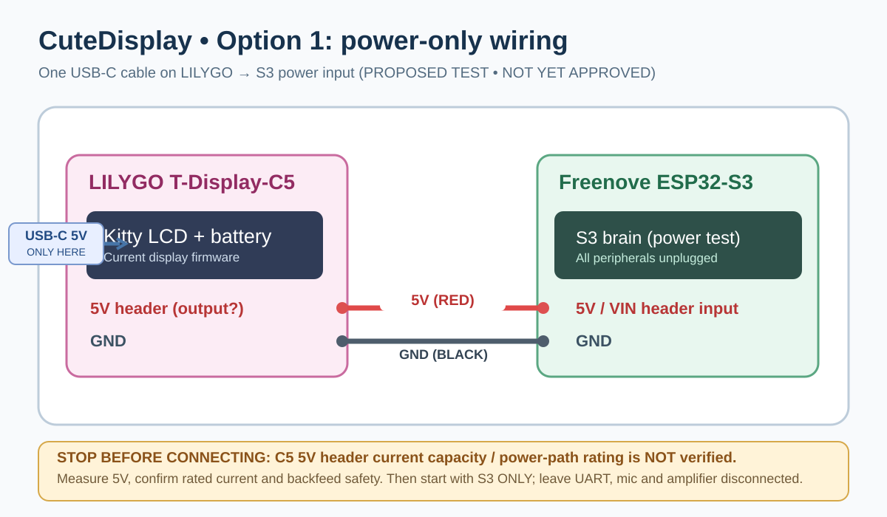

# CuteDisplay — Project Handoff / Resume Here

**Last updated:** 2026-10-26  
**Repository:** https://github.com/ryushi01/CuteDisplay  
**Default branch:** `main`  
**Purpose:** Durable context to resume engineering in a new ChatGPT conversation without access to previous chat history. **This document tracks plans separately from tested/working features.**

## FIRST: what to do in a new chat

Tell the assistant:

> Please read `docs/PROJECT_HANDOFF.md` and `README.md` from `https://github.com/ryushi01/CuteDisplay`, then review the current `main` firmware and iOS source. Continue CuteDisplay from the recorded implementation status. Do not assume untested features are working, and use the linked GitHub connector to commit changes when requested.

Read the actual repository before making code changes because this document can become stale.

## Latest status — 2026-10-26 loopbacks passed; UART pin mapping updated; cross-board pending

User flashed the previous S3 BLE diagnostic and confirmed its serial boot/advertising logs; user reports flashing current C5. S3 USB → C5 power booted both, but C5 USB → S3 lit power while S3 failed to boot. This is not a current-path safety rating, so user chose **separate USB supplies** for development and no 5V positive jumper. Do not power two USB supplies into common 5V rails.

**Current phase-1 source:** both Arduino firmware folders contain `CuteLink.h`; S3 UART1 GPIO47 TX/GPIO21 RX and USB console (help/status/ping/battery/msg/mood/mascot); C5 now uses UART1 **GPIO6 TX/GPIO1 RX** (previous GPIO4 TX/GPIO5 RX retired), HELLO/ACK and diagnostics. S3 original phase-1 sketch and original C5 phase-1 sketch were flashed and booted. **Independent UART loopback verified on both boards:** S3 physical jumper GPIO47↔21 echoed its own HELLO/ACK; C5 physical jumper GPIO6↔1 repeatedly showed matching TEST_18 through TEST_22 TX/RX. Earlier TX-only behavior was traced to bad contact at the C5 header and user had to press connector firmly. **Full new C5 firmware pin change not flashed yet; S3↔C5 exchange is NOT confirmed.** iPhone still connects straight to C5; S3 BLE service remains diagnostic only. Use [UART bring-up guide](hardware/uart-bringup.md). No robust retries, Japanese glyph UART, C5 battery BLE proxy, iPhone migration or AI/audio/camera.

## Product goal

Build a cute, multilingual (English/Japanese/French), animated, compact AI companion. Kitty/mascot remains on the **right side** of the LILYGO screen, with user messages/AI text readable elsewhere. Smooth, expressive mood-aware animations and accessories are a priority. Keep response text, BLE configuration, battery status, reconnection behavior and existing appearance controls working. The AI backend can be OpenAI or a separate user-hosted CPU-only Ollama/Open WebUI server (STT/TTS off-device). Camera support is **postponed**, not abandoned.

## Hardware and chosen architecture

**LILYGO T-Display-C5 / ESP32-C5 — FACE:**
- Integrated 320 × 170 LCD; autonomous mascot animations, messages, Japanese glyph handling, battery readings, local GPIO0 controls, display preferences.
- Existing firmware currently has direct BLE pairing and optional Wi-Fi fallback, retained during migration.
- Old INMP441/MAX98357A I²S audio loopback and GPIO28 long-press test have been **removed** from its firmware.
- Future S3 UART commands should tell C5 *what* to display and animate; do not stream LCD framebuffers over UART.

**Freenove ESP32-S3-WROOM CAM N16R8 (FNK0085B expected) — BRAIN:**
- Future iPhone BLE pairing, onboarding and local control. **Bluetooth stays in the design** even if Wi-Fi is used for AI/audio; remove BLE only if explicitly reconsidered following measured failures, not preemptively.
- Wi-Fi to external AI services, I²S microphone INMP441 and MAX98357A + 8 Ω/1 W speaker, orchestration and audio buffering.
- Onboard camera exists but **no camera wiring, software or tests in current stage**.
- Experimental S3 sketch `firmware/CuteDisplayBrain/CuteDisplayBrain.ino` advertises `CuteDisplay-Brain-DEV` over BLE service `FFF0`, characteristic `FFF1`; it **does not** run UART relay, I²S recording/playback, AI, phone migration or camera. It is a diagnostic starting point, not a deployable brain.
- A separate Waveshare 1.9-inch ST7789V2 screen was considered for possible later *single-board* migration, ONLY if benchmarks show S3 can run everything with smooth animation; current architecture is two boards.

**iPhone SwiftUI app:** Current `ios/CuteDisplay/ContentView.swift`, `BluetoothManager.swift`, and `AccessorySetup-InfoPlist.xml`. Direct BLE to LILYGO and authenticated Wi-Fi fallback are the current working source design. S3-only BLE pairing, proxy control, status relays and AccessorySetupKit migration still need implementation. Keep LILYGO recovery connectivity until S3 bridge proven.

## Repo source files

- `firmware/CuteDisplay/lcd.ino` — existing face firmware. Historical Drinks Mode already removed in source and previously confirmed working; audio loopback code removed. LCD renderer, BLE, Wi-Fi, moods, battery remain.
- `firmware/CuteDisplayBrain/CuteDisplayBrain.ino` — *incomplete* S3 BLE diagnostic sketch; source not independently compiled/flashed.
- `firmware/CuteDisplayBrain/BrainPinPlan.h` — proposed signal constants only, not active peripherals.
- `ios/CuteDisplay/ContentView.swift`, `ios/CuteDisplay/BluetoothManager.swift` — current app; no S3 migration yet.
- `docs/hardware/s3-c5-breadboard-plan.md` — proposed hardware signals, reserved GPIOs, and physical verification checklist.
- `docs/hardware/cutedisplay-s3-c5-breadboard.svg` — **multi-board wiring topology** displayed in README; not an exact hole-by-hole breadboard layout.
- `docs/hardware/option1-lilygo-powers-s3.svg` — **power-only experimental plan**, not approved until LILYGO 5V path verified.
- `docs/architecture/cutedisplay-dual-board.svg` — overall architecture.
- `docs/hardware/lilygo-c5-audio-breadboard.md` and `docs/hardware/cutedisplay-c5-audio-wiring.svg` — **retired/historical ONLY**; do not follow for new hardware build.

## Proposed wiring: UART + audio — NOT yet bench-verified

| Function | S3 | Other end |
| --- | --- | --- |
| UART S3 sends display commands | GPIO47 TX | LILYGO GPIO1 RX |
| UART C5 sends status | GPIO21 RX | LILYGO GPIO6 TX |
| UART shared reference | GND | LILYGO GND |
| I²S bit clock | GPIO41 | INMP441 SCK and MAX98357A BCLK |
| I²S word select | GPIO42 | INMP441 WS and MAX98357A LRC |
| Audio microphone input | GPIO1 | INMP441 SD |
| Audio amplifier output | GPIO2 | MAX98357A DIN |
| Mic power | 3V3 + GND | INMP441 VDD + GND; L/R grounded |
| Amp power | Verified rated supply (often 5V) + GND | MAX98357A VIN + GND |
| Speaker | MAX98357A SPK+/SPK− | 8 Ω speaker directly; never connect SPK− to ground |

These choices avoid documented S3 camera GPIO4–13,15–18, SD GPIO38–40 and octal PSRAM/flash pins. GPIO41 and GPIO42 are usable through the GPIO matrix but conflict with optional external JTAG functions. **Check exposed pin labels and any onboard peripheral assignment on exact Freenove board** before connecting.

LILYGO GPIO6 (TX) and GPIO1 (RX) are now selected after an actual local UART loopback pass; the original GPIO4/5 test produced TX-only output with poor jumper contact. Both S3 GPIO47/21 and C5 GPIO6/1 have passed standalone loopbacks, but the combined link still requires testing. Existing C5 LCD GPIO26/7/9/8/23/25, battery I²C 2/3/10, and GPIO0 user button must remain untouched.

**Basic phase-1 UART diagnostics are implemented in source; the two UART controllers were validated independently by loopback, not yet as a cross-board link.** Versioned bounded frames, CRC8, sequence ACK, HELLO, status/battery, ASCII console tests exist. Reliable retries, Japanese glyph chunks, BLE proxy and reconnection sync are not implemented. Do not migrate iPhone pairing yet.

## Current FIRST physical experiment: Option 1 — ONE USB-C ON LILYGO

Desired experience: Plug **one USB-C cable into the LILYGO** and let its 5V header also feed the S3. **Only two inter-board power wires for the FIRST test**, without UART, microphone, amp, speaker or camera:

| Source — LILYGO T-Display-C5 | Destination — Freenove S3 |
| --- | --- |
| **5V header** (candidate outgoing supply) | **5V/VIN header** (input; check pin label) |
| **GND** | **GND** |

**CRITICAL SAFETY GATE — DO NOT CONNECT S3 POWER YET JUST BECAUSE PINS SAY 5V.** We have NOT verified the LILYGO 5V header's current capacity or exact USB-VBUS current-limited/protected power path, nor backfeed behavior when programming S3 separately. A 5V voltage reading alone does **not** prove it can safely support the S3's Wi-Fi peak current. A large external USB adapter does not prove the LILYGO PCB's path can handle the extra load. Obtain the actual schematic/current ratings or manufacturer assurance and verify with measurement before powering the S3 via the C5. If capacity cannot be established, use two separate USB inputs temporarily or a protected single-input distribution board instead. Avoid bonding 5V/3V3 outputs from different regulators; no accidental positive-rail bridges. Only power/ground for initial test, with all other modules unplugged. When connecting UART later, mind unpowered-IO backfeeding.

The user expects their S3 board to arrive **2026-10-26** and wants to start with this power experiment. Before giving them specific pin positions, compare exact board photos and printed pin labels to the manufacturer schematic; the SVG is **conceptual and not a literal visual map of board connector orientation**.

### Why Wi-Fi + BLE is retained

BLE stays for onboarding, pairing, local settings and recovery; Wi-Fi connects the external AI backend. Streaming audio dropouts from BLE/Wi-Fi coexistence are a possible performance issue, **not an established problem**. Plan dedicated I²S DMA buffers, bounded task scheduling, ring buffers and robust networking; stress-test under simultaneous BLE before considering a Wi-Fi-only *operating mode*. The future app should be able to configure Wi-Fi over BLE.

## Validated vs pending

**Previously reported working by user:** Existing LILYGO display/iPhone integration, BLE reconnection/battery, animations, Drinks Mode removal. Actual firmware source changed to remove C5 I²S voice code, but no independent compile or physical regression test was performed here.

**Not validated or incomplete:** full S3↔C5 UART exchange (individual loopbacks passed), S3 Bluetooth pairing from iPhone, I²S mic/speaker, simultaneous BLE/Wi-Fi/STT/TTS, camera, Waveshare migration, exact long-term mechanical wiring and **Option 1 single-USB-C power path rating**.

## Engineering order to resume

1. **Power-path safety verification:** inspect S3 board and LILYGO labels + C5 VBUS-to-5V schematic/current rating. Only then power-only Option 1 test, or choose safe parallel supply.
2. **UART:** bring up TX/RX/GND, establish framing, restore display state, send iPhone commands through S3, report C5 telemetry.
3. **BLE app migration:** retain BLE on S3 for first-time configuration (and leave legacy C5 recovery BLE until new stack proven).
4. **S3 mic/amplifier:** compile local I²S record/playback with correct S3 GPIOs and tested supply.
5. **External STT → selected AI → TTS** and synchronized mascot animations.
6. **Benchmark Wi-Fi/BLE/audio**, then consider camera and optional alternate LCD.

## Requirements for code contributions

- Commit actual files to `main` when user asks; do not report pushed work without GitHub confirmation.
- Preserve working LILYGO mascot rendering, right-side character placement, Japanese text, BLE and battery behavior.
- Never accidentally reactivate removed Drinks Mode or former LILYGO audio loopback.
- Do not replace the iOS app with a hypothetical stub: its full Xcode project is not in this repo, only Swift source and Info.plist fragments.
- Distinguish documented intended pinout from electronically tested layout; never assert that the proposed power supply is safe without proof.
- Update this document whenever architectural decisions or milestone status change.
